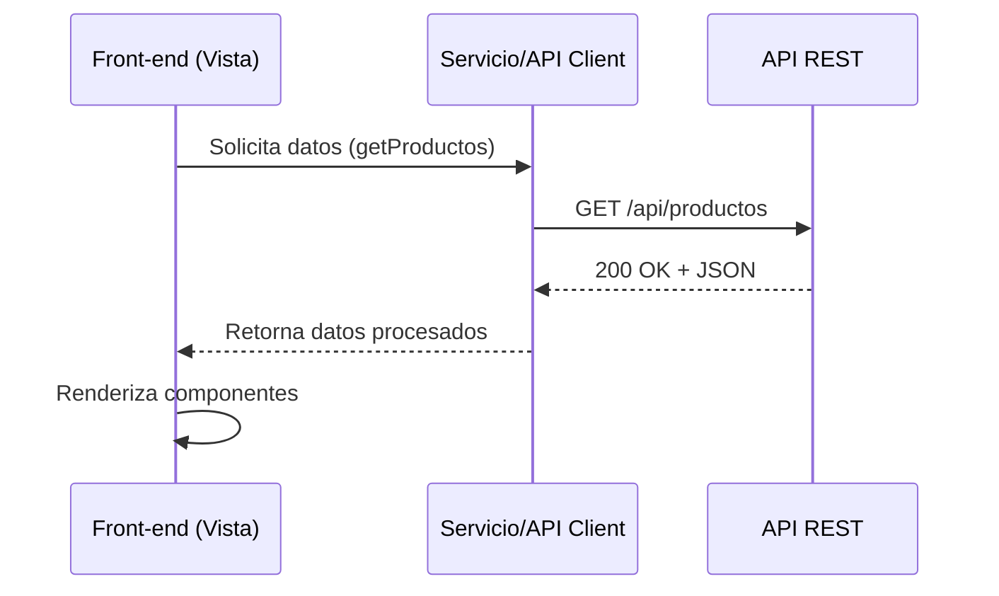
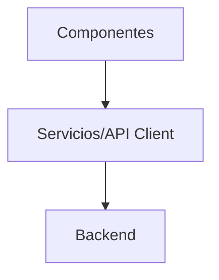
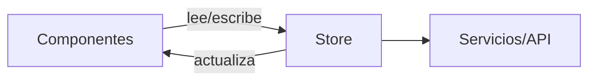
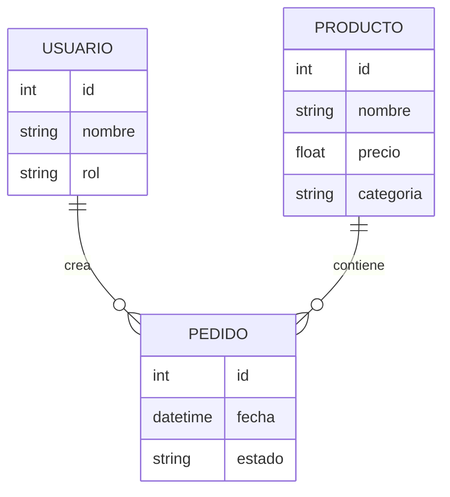
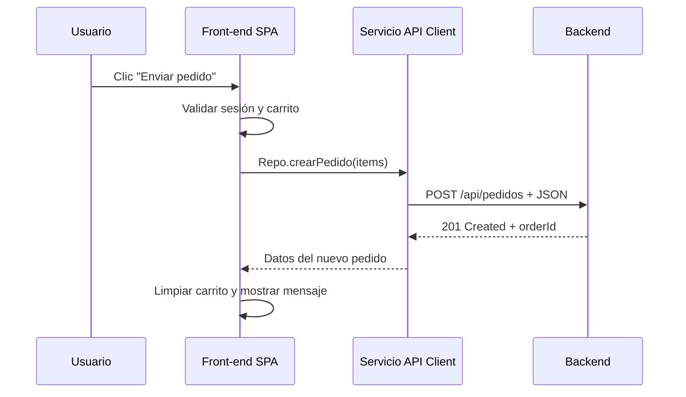
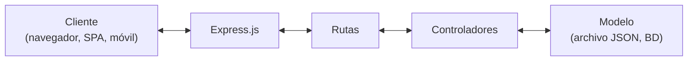
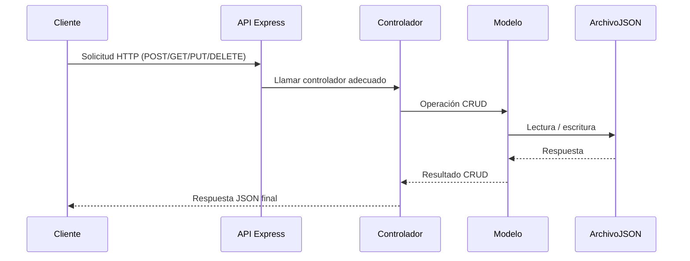
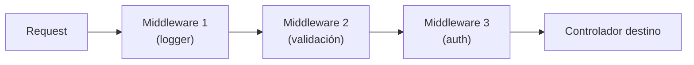
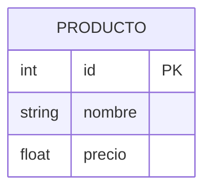

# Carrito de compras en Angular 19, Node.js y Express

Instrucciones para Codex en Visual Studio Code. Abre la carpeta de trabajo y pon a disposición de Codex este Markdown y los dos PDF del curso. Las referencias usan las páginas físicas de cada archivo.

- **Semana 10 — `teoria semana 10.pdf` (58 páginas).** Fuente del carrito, sus entidades y secuencias, y los fragmentos de Angular.
- **Clase 9 — `profundizacion1_clase9.pdf` (5 páginas).** Fuente de la arquitectura de Express, sus diagramas, el almacenamiento en archivos JSON y el formato de las respuestas.

## 1. Objetivo y fuente

Implementa y verifica el carrito que se describe en **10.5, apartado 8, «Ciclo completo de integración con API»**, páginas **32–33** de Semana 10, figura **20**. El recorrido empieza con un producto en el catálogo y termina cuando el backend crea el pedido, la aplicación vacía el carrito y aparece la confirmación. Usa **Angular 19 Standalone** según las páginas **38–43** y una API de **Node.js con Express** según Clase 9. Sirve el frontend compilado con **Live Server de VS Code** y ejecuta Express en otra terminal.

Lee los dos PDF y revisa si la carpeta contiene archivos del curso. La pág. 19 de Semana 10 menciona **CaféCat SPA** para explicar «Agregar al carrito». Reutiliza el material original que corresponda al ejemplo. Usa los fragmentos específicos de Angular 19 y conserva los participantes, el orden, las flechas y los rótulos de las secuencias. Las transcripciones Mermaid reproducen la lógica de los diagramas. Consulta las páginas originales para su apariencia gráfica.

Semana 10 proporciona fragmentos de Angular. Clase 9 proporciona diagramas y un ejemplo literal de error JSON. Ninguno trae el proyecto completo del carrito. El estudiante autorizó una solución simple para el formato del pedido, el inicio de sesión y el CSS. Esos detalles se fijan en las secciones 4 y 5 como decisiones de esta práctica. Con los dos PDF y esta guía hay información suficiente para implementar y probar ambos procesos desde cero.

## 2. Alcance y trazabilidad

| Fuente del PDF | Aplicación al carrito |
| --- | --- |
| Págs. 1–6, introducción y §10.1 | La aplicación es un frontend moderno, declarativo y basado en componentes. La evolución de frameworks y el RDA general contextualizan la clase. |
| Págs. 6–13, §10.2, figs. 3–8 | Separa componentes de presentación y vistas contenedoras. Compón la vista con piezas reutilizables, usa bindings para renderizar los cambios y sigue el ciclo de vida de Angular. Las figuras de composición y diseño atómico explican la organización. |
| Págs. 13–19, §10.3, figs. 9–12 | Los datos bajan del padre al hijo. Los clics generan eventos, el manejador cambia el estado y Angular vuelve a renderizar la interfaz. La pág. 19 vincula este patrón con las tarjetas de productos y «Agregar al carrito». |
| Págs. 20–27, §10.4, figs. 13–15 | Separa vistas y componentes de los servicios. La jerarquía, el flujo de navegación y la solicitud de datos de la vista explican cómo se conectan las capas. |
| Págs. 27–33, §10.5, figs. 16–20 | Implementa la carga de productos, la capa API Client, el estado compartido, las entidades descritas y el envío del pedido. Respeta los métodos, rutas, códigos y orden de los diagramas. |
| Págs. 38–44, Angular 19 Standalone | Conserva los ejemplos Angular aplicables de componentes, plantillas, servicios, inyección, observables, rutas, ciclo de vida y compilación. Las págs. 43–44 también describen ventajas y limitaciones. |
| Págs. 34–37 y 45–58 | Las preguntas de evaluación y los materiales de React y Vue se conservan como material de lectura de la clase. Los fragmentos ejecutables de este proyecto salen de la sección Angular. |
| Clase 9, págs. 1–5 | Implementa la API con Express, separa rutas, controladores, modelos y middleware, usa archivos JSON y estandariza las respuestas. |

Las figuras genéricas muestran también dashboard, tabla de usuarios y gráfico de ventas. La página 19 menciona el panel de administración de CaféCat, la tabla 11 enumera operaciones HTTP de ejemplo y las páginas 41–42 ilustran una ruta de creación y un formulario de productos. El recorrido del carrito usa las operaciones de **leer productos** y **crear el pedido**, más el inicio de sesión de prueba que permite ejecutar la validación de la figura 20.

## 3. Diagramas y contrato del flujo

### 3.1. Cargar productos — figura 16, página 28



En el arranque de la vista, solicita los productos por medio del servicio Angular e incorpora la respuesta al estado. La figura usa la etiqueta `getProductos`. El servicio específico de Angular de la página 40 llama `listar()` a esa operación. Mantén `listar()` en el código Angular y un solo punto de acceso al GET.

### 3.2. Capas y estado — figuras 17 y 18, página 30

**Figura 17 — Service Layer Pattern.**



**Figura 18 — State Management Pattern.**



- **Figura 17.** Componentes → Servicios/API Client → Backend. La URL y la llamada HTTP viven en el servicio. Inyecta el servicio en Angular.
- **Figura 18.** Los componentes leen y escriben en el estado compartido. El estado actualiza a los componentes y se apoya en Servicios/API para obtener o enviar datos. La figura y el texto contemplan usuario actual, productos cargados, carrito y sesión activa.
- **Páginas 18 y 24.** Usa servicios Angular con RxJS para el estado compartido si se inicia el frontend desde cero. El PDF menciona esta opción y también NgRx. Si el proyecto del curso ya resuelve el estado con una de ellas, conserva esa implementación.
- **Figuras 9 y 10, páginas 14 y 16.** App → lista de productos → tarjeta de producto → interfaz renderizada. Para «Agregar al carrito», sigue clic → manejador → actualización del estado → interfaz actualizada. En Angular, pasa los datos del producto con inputs y comunica la acción al contenedor con un evento. Las tarjetas muestran datos y el contenedor coordina la carga y el estado, como indican las páginas 9 y 30–31.
- **Páginas 17–19.** Los productos agregados son estado del carrito. Las cantidades y el total aparecen como ejemplos de estado y estado derivado. Para esta práctica, cada clic agrega una unidad. La lista de identificadores conserva una entrada por unidad.

### 3.3. Entidades — figura 19, página 31



| Entidad | Campos y tipos tal como aparecen |
| --- | --- |
| `USUARIO` | `id: int`, `nombre: string`, `rol: string` |
| `PRODUCTO` | `id: int`, `nombre: string`, `precio: float`, `categoria: string` |
| `PEDIDO` | `id: int`, `fecha: datetime`, `estado: string` |

El diagrama enlaza **USUARIO**, **PEDIDO** y **PRODUCTO** con las relaciones rotuladas **crea** y **contiene**. La notación dibujada tiene `||` en los extremos de USUARIO y PRODUCTO y círculo con pata de cuervo en los extremos de PEDIDO. Conserva el ER conceptual con esa notación. La sección 5 fija por separado la representación JSON de `items` y `fecha` para ejecutar la figura 20. Usa `number` en TypeScript para los campos `int` o `float`. El identificador de la entidad se llama `id` en el archivo de pedidos y se devuelve como `orderId` en la respuesta de creación.

### 3.4. Enviar pedido — figura 20, páginas 32–33



1. El usuario agrega un producto con **«Agregar al carrito»** (pág. 19). El estado cambia y el carrito se actualiza en la interfaz.
2. El usuario pulsa **«Enviar pedido»** (fig. 20). La SPA valida **sesión y carrito antes de invocar el servicio**. Ante una sesión inválida o un carrito vacío, no envía el POST.
3. La SPA invoca **`Repo.crearPedido(items)`** según la figura. `Repo` representa el cliente de pedidos. Conserva el nombre **`crearPedido`** y resuelve el objeto inyectado según la capa de servicios. El diagrama no aporta una clase de repositorio adicional.
4. El servicio usa `HttpClient` y realiza **`POST /api/pedidos`** con el cuerpo JSON `{ "items": [1] }` cuando el carrito contiene una unidad del producto 1. La sección 5 fija el contrato completo.
5. El backend devuelve **`201 Created`** con **`data.orderId`**. El servicio usa `observe: 'response'` para verificar el estado HTTP y entrega los datos del nuevo pedido a la vista.
6. **Después** de verificar el éxito, limpia el estado del carrito y muestra **«Pedido creado. ID: …»**. Ante error, conserva el carrito y muestra el mensaje aplicable (págs. 29 y 32). Usa el estado de carga para impedir otro envío o modificaciones del carrito mientras se procesa el pedido.

### 3.5. Carga, errores y sesión — página 29 y tabla 12, página 32

- Distingue carga, falta de datos, error de red y errores de autorización `401/403`. Mantén los estados visibles mediante renderizado condicional.
- La pág. 29 menciona JWT, encabezados `x-user-id` y `x-user-role` y cookies. Esta práctica usa una cookie de sesión administrada por Express y un botón **«Iniciar sesión de prueba»**, según la sección 5. Ante `401`, invalida el estado de sesión en Angular y vuelve a mostrar el botón. Trata `403` como denegación de acceso. Conserva el carrito en ambos casos.
- La tabla 12 indica centralizar HTTP, manejar la carga, registrar diagnósticos, atender expiración de sesión, validar en servidor, usar interfaces o DTOs y evitar duplicar datos. También presenta reintentos automáticos como práctica general. Para el envío de pedidos, conserva las reglas de reintento del backend. Reenviar automáticamente un POST sin un contrato de idempotencia puede crear dos pedidos.

## 4. Estructura y fragmentos de Angular

Usa la estructura de **Angular 19 Standalone** de la pág. 43, que el PDF imprime así:

```text
src/
  app/
    features/
    services/
    models/
    app.component.ts
  main.ts
  app.config.ts
```

La pág. 25 muestra otro árbol Angular con `app.module.ts`. Para este proyecto aplica el árbol de la pág. 43 y el arranque standalone de las págs. 38–39. En un proyecto nuevo, ajusta las rutas de importación si el generador deja `app.config.ts` dentro de `src/app/`. Coloca las vistas y componentes de la funcionalidad en `features/`, las interfaces en `models/` y la comunicación HTTP en `services/`. La pág. 28 identifica servicios de productos, autenticación y pedidos mediante ejemplos genéricos en `.js`. En Angular utiliza TypeScript y conserva la separación por responsabilidad.

### Componente y plantilla — páginas 39–40

Conserva el selector, clase, título y ruta de plantilla del ejemplo. Agrega los imports requeridos para usar componentes o directivas standalone, las propiedades del flujo y su lógica.

```ts
@Component({
  selector: 'app-productos',
  standalone: true,
  templateUrl: './productos.component.html'
})
export class ProductosComponent {
  titulo = 'Listado de productos';
}
```

```html
<h1>{{ titulo }}</h1>
```

Fragmento de listado en tabla de la pág. 40. Para la tarjeta del caso CaféCat de la pág. 19, conserva la iteración con `*ngFor` y el binding del producto. Si la plantilla original usa la tabla, reutiliza su fila literal. Usa `*ngIf` para los estados condicionales.

```html
<tr *ngFor="let p of productos">
  <td>{{ p.nombre }}</td>
</tr>
```

El ejemplo de evento de la pág. 40 usa `(click)`. En el carrito, aplica ese binding a los dos controles nombrados en las págs. 19 y 33. El documento ilustra también `[(ngModel)]`, `[src]` y `*ngSwitch` en ejemplos separados de plantillas. La figura 20 no requiere un formulario de producto ni una imagen para enviar un pedido.

### Servicio e inyección — páginas 40–41

```ts
@Injectable({ providedIn: 'root' })
export class ProductosService {
  constructor(private http: HttpClient) {}

  listar() {
    return this.http.get('/api/productos');
  }
}
```

```ts
constructor(private productosSrv: ProductosService) {}
```

La pág. 29 muestra el consumo del servicio con este fragmento:

```ts
this.productosService.getProductos().subscribe(data => {
  this.productos = data;
});
```

La pág. 41 muestra también el tipado de la petición y la asignación en la suscripción:

```ts
this.http.get<Producto[]>(url)
  .subscribe(prods => this.productos = prods);
```

Para unir ambos ejemplos, mantén `listar()`, el literal `'/api/productos'` y la inyección por constructor de la pág. 40. Como Clase 9 pide `status` y `data` en el JSON, tipa la respuesta HTTP como `{ status: 'ok'; data: Producto[] }` y extrae `data` dentro del servicio mediante RxJS. El componente se suscribe a `listar()` y sigue recibiendo `Producto[]`. La figura de inyección de la pág. 41 muestra **Componente → Injector → ProductosService**. Registra `provideHttpClient()` en la configuración de arranque para resolver `HttpClient`.

### Router, arranque y ciclo de vida — páginas 39, 41 y 42

Conserva `provideRouter(routes)` en `app.config.ts`. La pág. 41 muestra este ejemplo literal de rutas:

```ts
export const routes: Routes = [
  { path: '', component: HomeComponent },
  { path: 'crear', component: CrearProductoComponent },
  { path: '**', redirectTo: '' }
];
```

Para el flujo del carrito, resuelve la ruta inicial al componente que contiene el catálogo y el carrito. El ejemplo de `crear` ilustra cómo asociar un componente al router. Si el proyecto original ya tiene esa ruta, consérvala. Usa el arranque standalone de Angular en `main.ts` y el `RouterOutlet` para mostrar la vista enrutada. La pág. 41 representa navegación → router → coincidencia → componente → renderizado. Carga los datos en `ngOnInit()` y libera suscripciones de larga duración al destruir su componente. La tabla de la pág. 42 sitúa `ngOnChanges()` cuando cambian los inputs y `ngAfterViewInit()` después de renderizar la vista inicial. Incorpora esos hooks únicamente si el componente necesita lógica en ese momento.

### Estilos y contenido visual

La pág. 39 contempla hojas de estilo opcionales. Si existe CSS del ejemplo de clase, consérvalo. Para empezar desde los PDF, usa una sola vista con el botón de sesión, el catálogo y el carrito en bloques uno debajo del otro. Aplica CSS local mínimo para márgenes, separación entre elementos y un borde fino en tarjetas. Usa colores, tipografía y botones nativos del navegador. Conserva **«Listado de productos»**, **«Agregar al carrito»** y **«Enviar pedido»**. El CSS mínimo es una decisión de esta práctica.

## 5. Backend con Node.js y Express

### 5.1. Diagramas del recurso de Clase 9

**Vista general de Express, pág. 2.**



**Flujo CRUD, pág. 3.**



**Flujo de middleware, pág. 3.**



**Representación ER conceptual, pág. 4.**



Conserva este diagrama de Clase 9 y el de Semana 10 como referencias distintas. El producto de la práctica incluye también `categoria`, tal como aparece en la figura 19 de Semana 10. La pág. 2 de Clase 9 enumera `POST /api/productos`, `GET /api/productos`, `GET /api/productos/:id`, `PUT /api/productos/:id` y `DELETE /api/productos/:id` como ejemplos de CRUD. Aplica el patrón al **GET de productos** y al **POST de pedidos** que aparecen en las figuras 16 y 20 de Semana 10.

### 5.2. Estructura y responsabilidades

Usa la separación de Clase 9, págs. 2–3. Este árbol concreta nombres de archivos para la práctica.

```text
backend/
  app.js
  package.json
  routes/
    productos.routes.js
    pedidos.routes.js
    sesion.routes.js
  controllers/
    productos.controller.js
    pedidos.controller.js
    sesion.controller.js
  models/
    productos.model.js
    pedidos.model.js
  middlewares/
    logger.js
    validacion.js
    auth.js
    errorHandler.js
  data/
    productos.json
    pedidos.json
```

- **Rutas.** Monta los routers bajo `/api`. El router de pedidos ejecuta la validación del cuerpo y luego `auth` antes de llamar al controlador. La lectura del catálogo y la creación de sesión son públicas en esta práctica.
- **Controladores.** El controlador de productos pide al modelo que lea el catálogo. El de pedidos coordina la comprobación de que los productos existen y solicita al modelo guardar el pedido. El de sesión crea la sesión de prueba.
- **Modelos.** Lee y escribe archivos JSON usando `node:fs/promises` y rutas resueltas desde los archivos del backend. El catálogo se lee de `productos.json`. Inicializa `pedidos.json` con `[]` al crear el proyecto y conserva sus pedidos al reiniciar. En el modelo de pedidos, serializa la lectura, asignación del ID y escritura dentro del mismo proceso. Escribe primero un temporal en la misma carpeta y reemplaza el JSON al completar la escritura. Responde `201` solo después de guardar.
- **Middlewares.** Registra hora, método y ruta en `logger`. Instálalo antes de `express.json()` para registrar también solicitudes con JSON mal formado. Monta la sesión antes de los routers. Dentro del POST de pedidos, respeta **logger → validación → auth → controlador**. Coloca `errorHandler(err, req, res, next)` después de rutas y del manejo de rutas inexistentes. Devuelve JSON también ante un cuerpo inválido o un error al leer/escribir. Registra el diagnóstico en la terminal y mantén la API disponible.

### 5.3. Contrato JSON para esta práctica

Clase 9, pág. 4, pide respuestas con `status` y `data` o `message`. El valor `ok`, el cuerpo `{ items: number[] }` y el lugar de `orderId` dentro de `data` son decisiones mínimas de integración. Las rutas y los códigos de productos y pedidos vienen de Semana 10.

**`GET /api/productos` → `200 OK`.** `data` es la lista de productos. Para arrancar desde cero, guarda en `productos.json` la lista que se muestra en `data`. El nombre y precio se toman del ejemplo de producto de Semana 10, pág. 53. `id` y `categoria` son datos de prueba para completar la entidad.

```json
{
  "status": "ok",
  "data": [{ "id": 1, "nombre": "Café", "precio": 10.5, "categoria": "Bebidas" }]
}
```

**`POST /api/pedidos` → `201 Created`.** Enviar `Content-Type: application/json` y este cuerpo cuando se ha agregado una unidad del producto 1.

```json
{ "items": [1] }
```

`items` debe ser una lista con al menos un ID entero positivo. Si el mismo producto se agregó dos veces, se envía su ID dos veces. Si el cuerpo es incorrecto o algún producto no existe, devuelve `400` con el formato de error de abajo. El servidor toma el usuario de la sesión, genera el siguiente ID numérico a partir de los pedidos guardados, usa la fecha actual en ISO 8601 y asigna el estado inicial `creado`. Guarda `id`, `fecha`, `estado`, `usuarioId` e `items` en el archivo de pedidos. `usuarioId` e `items` representan las referencias necesarias para ejecutar el flujo en JSON. El diagrama ER de la pág. 31 queda como está.

Ejemplo de respuesta de creación. La fecha y el ID reales se generan en el servidor.

```json
{
  "status": "ok",
  "data": {
    "orderId": 1,
    "fecha": "2026-01-01T00:00:00.000Z",
    "estado": "creado"
  }
}
```

**Errores.** Este es el ejemplo literal de Clase 9, pág. 3.

```json
{
  "status": "error",
  "message": "Error interno del servidor",
  "detail": "Archivo no encontrado"
}
```

Para las respuestas de la API conserva `status: "error"` y un `message` apropiado. Usa `detail` solo si contiene información apta para el cliente. Reserva diagnósticos internos para la terminal, según las págs. 3–4. Devuelve `400` ante un cuerpo inválido, `401` si falta la sesión, `403` si una sesión válida carece de permiso, `404` para rutas de API inexistentes y `500` ante fallos internos.

### 5.4. Inicio de sesión de prueba

Agrega **«Iniciar sesión de prueba»** a la vista. El botón llama a **`POST /api/sesion`** con `{}`. Express crea una sesión para el usuario local `{ id: 1, nombre: 'Estudiante', rol: 'cliente' }` y responde `200` con `{ status: 'ok', data: usuario }`. La identidad se fija en el servidor. Es una entrada de demostración de un clic para esta práctica.

- Usa `express-session` con almacenamiento en memoria para la demostración local, `resave: false`, `saveUninitialized: false` y un secreto generado al arrancar mediante `randomBytes(32).toString('hex')` de `node:crypto`. Crea una nueva sesión al iniciar, asigna el usuario en `req.session` y envía la cookie con `httpOnly: true`, `sameSite: 'lax'` y `path: '/api'`. Usa `secure: false` para la prueba HTTP local con Live Server. El navegador conserva y envía la cookie en el mismo origen a través del proxy.
- Angular mantiene al usuario devuelto en su estado en memoria. Al recargar la página puede volver a pulsar el botón. El middleware `auth` lee la sesión del servidor. Si no hay usuario, devuelve `401`. Si el usuario de la sesión tiene un rol diferente de `cliente`, devuelve `403`. El controlador toma `usuarioId` de esa sesión.
- Si Express se reinicia, la sesión de prueba expira y los pedidos guardados permanecen en el archivo. Ante `401`, Angular permite iniciar una nueva sesión y conserva los productos del carrito.

## 6. Orden de implementación

1. **Revisa ambos PDF y la carpeta.** Conserva el material de clase aplicable. Si la carpeta contiene solo los PDF y la guía, genera el proyecto con los valores y contratos de este documento.
2. **Prepara Angular 19.** Reutiliza el proyecto si existe. Si se empieza desde una carpeta vacía, genera una aplicación Angular 19 Standalone con Angular CLI, routing, CSS y renderizado en cliente. El siguiente comando es de preparación. Usa el nombre del ejemplo de salida de la pág. 43 si el proyecto del curso no tiene nombre propio:

   ```powershell
   node --version
   npm --version
   npx --package @angular/cli@19 ng new productos-crud-angular --standalone --routing --style=css --ssr=false --skip-git
   cd productos-crud-angular
   npx ng version
   ```

   Comprueba que el CLI y el framework instalados sean de la serie 19. Node.js 22.x es una opción compatible según la tabla oficial de Angular. Mantén los archivos de configuración que requiera la compilación con esbuild y elimina el contenido de bienvenida del CLI de la plantilla de la práctica.
3. **Prepara Express.** Desde la raíz de Angular crea la carpeta `backend/`. Inicializa su propio `package.json`, instala las dependencias y define el script `start`.

   ```powershell
   New-Item -ItemType Directory -Force backend | Out-Null
   Set-Location backend
   npm init -y
   npm install express@5 express-session
   npm pkg set "scripts.start=node app.js"
   ```

   Crea los archivos de la sección 5 en JavaScript CommonJS. Implementa los tres endpoints y los errores. Haz que `app.js` escuche en `127.0.0.1:3000` para la ejecución local. Los comandos de instalación, archivos concretos y puerto son configuración de esta práctica. En una copia que ya trae los archivos de dependencias, instala con `npm ci` usando el lockfile.
4. **Arma el frontend.** Conecta el arranque, la ruta inicial y los providers. Define modelos que coincidan con las entidades y el contrato JSON. Usa `ProductosService.listar()` para el catálogo. Compón la lista con inputs y eventos.
5. **Conecta carrito, sesión y pedidos.** «Agregar al carrito» cambia el estado compartido y «Iniciar sesión de prueba» guarda al usuario devuelto. Al pulsar «Enviar pedido», valida sesión y carrito, y llama a `crearPedido(items)`. Comprueba `201` y `data.orderId` antes de vaciar el carrito. Refleja carga y errores en la interfaz.
6. **Compila y ejecuta.** Arranca la API con `npm start` desde `backend/`. Compila Angular y abre su salida con Live Server siguiendo la sección 7.
7. **Verifica la entrega.** Ejecuta las pruebas de la sección 8. Deja ambos proyectos listos en el espacio de trabajo y documenta los comandos de arranque, la URL local y el resultado de las pruebas.

## 7. Compilación y ejecución con Live Server

### Comando de la página 43

```powershell
ng build --configuration production
```

Usa `npx ng build --configuration production` si el CLI está instalado solo en el proyecto. El ejemplo del PDF indica `dist/productos-crud-angular/`. Localiza el `index.html` efectivamente compilado. Si el builder lo deja en `dist/productos-crud-angular/browser/`, sirve esa carpeta como raíz web. El frontend se ejecuta a partir de la salida compilada.

### Configuración operativa solicitada para VS Code

1. Abre en VS Code la raíz del proyecto Angular. En una terminal ubicada en `backend/`, ejecuta `npm start`. La API de la práctica escucha en `http://127.0.0.1:3000`. Live Server sirve el frontend estático y reenvía las peticiones. Express recibe y responde las operaciones de la API.
2. Configura `liveServer.settings.root` para que apunte a la carpeta del `index.html` compilado, relativa al workspace y con `/` inicial. Si se usa la raíz del build indicada arriba, el valor será `/dist/productos-crud-angular/browser`. Cambia el valor si la salida real es otra.
3. Activa el proxy de la extensión con `baseUri: "/api"` y `proxyUri: "http://127.0.0.1:3000/api"`. Comprueba en Express que cada ruta recibida conserva un solo prefijo `/api`. Este paso mantiene las rutas literales de `HttpClient` y deja al navegador en el mismo origen para guardar y enviar la cookie. Si se cambia el puerto de Express, actualiza el destino del proxy.
4. Si el proyecto usa navegación SPA a rutas internas, configura `liveServer.settings.file` como `index.html` para que una recarga de la ruta sirva la entrada de la aplicación. Comprueba que `/api` sigue encaminado al backend.
5. Usa **Go Live** u **Open with Live Server** sobre la salida compilada. Abre la ruta raíz de la URL que informe la extensión. En DevTools, verifica la respuesta de `GET /api/productos`, la cookie de `POST /api/sesion` y el `201` de `POST /api/pedidos`. Comprueba que se cargan los archivos de la compilación. Después de editar TypeScript, vuelve a compilar para que Live Server sirva el código nuevo.

Configuración de `.vscode/settings.json` para la salida de ejemplo. Ajusta la raíz si cambia la carpeta de compilación.

```json
{
  "liveServer.settings.root": "/dist/productos-crud-angular/browser",
  "liveServer.settings.file": "index.html",
  "liveServer.settings.proxy": {
    "enable": true,
    "baseUri": "/api",
    "proxyUri": "http://127.0.0.1:3000/api"
  }
}
```

Fuentes técnicas de arranque y ejecución, separadas de la consigna del curso.

- [Angular CLI 19 — creación del proyecto](https://v19.angular.dev/cli/new)
- [Angular — compatibilidad de versiones](https://angular.dev/reference/versions)
- [Angular 19 — bootstrapApplication](https://v19.angular.dev/api/platform-browser/bootstrapApplication) y [provideHttpClient](https://v19.angular.dev/api/common/http/provideHttpClient)
- [Angular 19 — despliegue](https://v19.angular.dev/tools/cli/deployment)
- [Express — instalación](https://expressjs.com/en/starter/installing/), [manejo de errores](https://expressjs.com/en/guide/error-handling/) y [middleware de sesión](https://expressjs.com/en/resources/middleware/session/)
- [Configuración oficial de Live Server para VS Code](https://github.com/ritwickdey/vscode-live-server/blob/master/docs/settings.md) y [documentación del autor sobre el servidor de backend](https://github.com/ritwickdey/live-server-web-extension#the-common-misconception)

## 8. Pruebas de aceptación

| Caso | Resultado que debe comprobarse | Fuente |
| --- | --- | --- |
| Abrir la URL de Live Server | Carga el frontend compilado y se ve la vista Angular. | Indicación del estudiante y pág. 43 |
| Cargar el catálogo | El cliente emite `GET /api/productos`, obtiene `200 OK` y JSON con `status` y `data`, y renderiza la lista. | Semana 10, fig. 16, y Clase 9, pág. 4 |
| Agregar un producto | El evento actualiza el estado y se ve el producto en el carrito. | Figs. 9–10, págs. 14 y 16, y pág. 19 |
| Iniciar sesión desde Live Server | `POST /api/sesion` devuelve `200`, el navegador recibe la cookie y la vista refleja la sesión. | Sesión de prueba de la sección 5 |
| Enviar con sesión válida y carrito con productos | `POST /api/pedidos` envía `items` como JSON. Express guarda el pedido y devuelve `201 Created` con `data.orderId`. La SPA vacía el carrito y muestra el mensaje. | Semana 10, fig. 20, y Clase 9, flujo CRUD |
| Pulsar enviar con carrito vacío o sin iniciar sesión | La validación de Angular impide el POST. | Semana 10, fig. 20 |
| Probar el POST directamente sin cookie, con JSON válido | Express responde `401` con `status: "error"` y `message`. No se guarda un pedido. | Clase 9, middleware `auth`, y Semana 10, pág. 29 |
| Probar un cuerpo inválido y una ruta inexistente | Express devuelve `400` y `404`, respectivamente, con el formato JSON de error. | Clase 9, págs. 3–4 |
| Reiniciar Express con el carrito de la pestaña abierto | Los pedidos ya guardados permanecen en JSON. Si se intenta enviar con la sesión previa, Express responde `401` y Angular permite volver a iniciar sesión conservando el carrito. | Clase 9, archivo JSON, y sesión de prueba |
| Comprobar carga, catálogo vacío, fallo de red y `403` | La vista refleja el estado correspondiente. Si falla un envío, conserva el carrito. Reproduce el `403` con una sesión de prueba controlada sin permiso para crear pedidos. | Semana 10, pág. 29 y tabla 12 |

La prueba principal requiere abrir Live Server, comprobar **GET 200**, iniciar sesión de prueba, agregar un producto, comprobar **POST 201 con identificador** y ver el carrito vacío con la confirmación. Verifica además que el ID devuelto corresponde al registro del archivo JSON. Informa qué pruebas se ejecutaron y qué resultado tuvieron.
